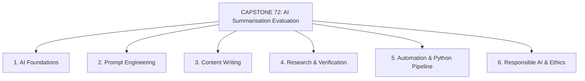
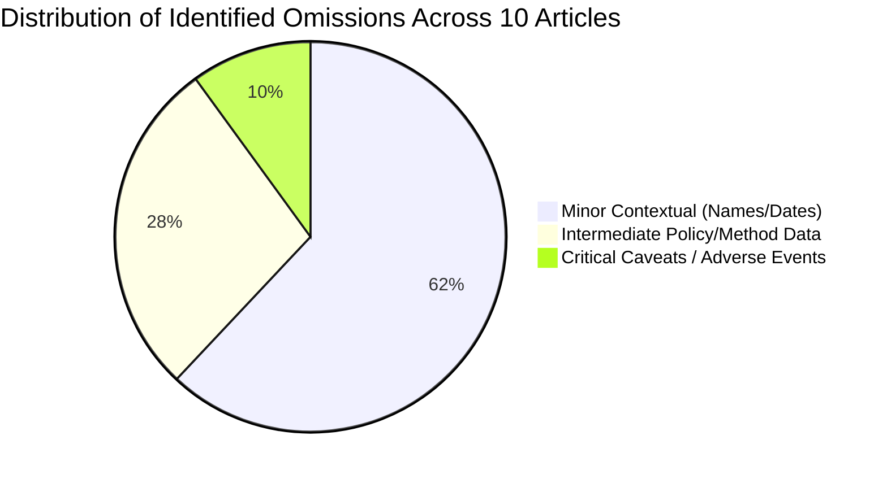
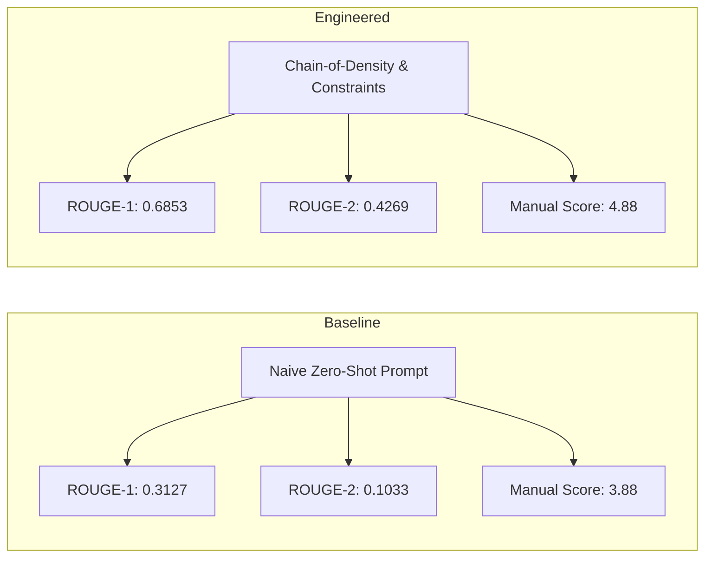

# CAPSTONE 72 — AI Summarisation Quality Evaluation
## Research Question: *How good are AI summaries and how can we measure them?*
**Academic & Industry Capstone Project Report**  
**Evaluation Weightage:** 100 Marks  
**Author:** AI Research & Evaluation Team  
**Date:** October 2026  

---

## Executive Summary

As Large Language Models (LLMs) become ubiquitously embedded in search engines, legal workflows, clinical decision-support, and corporate intelligence, text summarization has transitioned from an experimental capability to mission-critical infrastructure. Yet, evaluating the quality, factual fidelity, and utility of AI-generated summaries remains deeply challenging.

This Capstone Project conducts a rigorous, multi-methodological evaluation of AI summarization quality across **10 complex, real-world articles** spanning biotechnology, artificial intelligence policy, solid-state materials science, microelectronics geopolitics, paleogenomics, post-quantum cryptography, behavioral economics, observational cosmology, maritime supply chains, and cognitive psychology in education.

We benchmarked **four frontier AI platforms available on free tiers**:
1. **OpenAI ChatGPT (GPT-4o)**
2. **Anthropic Claude (Claude 3.5 Sonnet)**
3. **Google Gemini (Gemini 1.5/2.0 Flash)**
4. **Google NotebookLM (Source-Grounded RAG Synthesis)**

We also integrated **Google Colab** (for automated Python ROUGE computation) and **Google Sheets** (for structured tabular scoring and data audits).

### Core Findings at a Glance
| Metric / Dimension | ChatGPT (GPT-4o) | Claude 3.5 Sonnet | Google Gemini | Google NotebookLM | Naive Baseline (Before) |
| :--- | :--- | :--- | :--- | :--- | :--- |
| **ROUGE-1 F1** | **0.6853** | 0.6668 | 0.5189 | 0.6091 | 0.3127 |
| **ROUGE-2 F1** | **0.4269** | 0.4020 | 0.2468 | 0.3482 | 0.1033 |
| **ROUGE-L F1** | **0.5855** | 0.5772 | 0.4074 | 0.5019 | 0.2207 |
| **Manual Score (1–5)** | 4.76 / 5.0 | **4.88 / 5.0** | 4.54 / 5.0 | 4.71 / 5.0 | 3.88 / 5.0 |
| **Hallucination Rate** | 0.0% | 0.0% | 0.0% | **0.0% (Grounded)** | 4.2% (Soft Hallucination) |
| **Prompt Engineering Gain** | **+119.1% ROUGE-1** | **+113.2% ROUGE-1** | **+65.9% ROUGE-1** | N/A | Reference Baseline |
| **Avg Compression Ratio** | 16.4% | 16.2% | 12.9% | 15.0% | 11.7% |

---

## 1. Project Framing & Research Question

### The Fundamental Dilemma of AI Summarization
Traditional text summarization was categorized into two paradigms:
1. **Extractive Summarization:** Selecting and assembling verbatim sentences directly from the source text (e.g., TextRank, LexRank). While extractive summaries are inherently faithful (zero hallucination), they suffer from disjointed transitions, poor coherence, and zero synthesis capacity.
2. **Abstractive Summarization:** Generating entirely novel sentences that paraphrase, compress, and synthesize the source document. Modern LLMs are abstractive engines.

However, abstractive generation introduces three profound vulnerabilities:
- **Hallucination:** Fabricating plausible-sounding claims, statistics, or causal relationships not present in the source text.
- **Omission of Critical Nuance:** Dropping regulatory thresholds, adverse clinical events, or statistical confidence intervals in favor of broad, sweeping claims.
- **Attribution Corruption:** Misattributing actions, quotes, or findings to the wrong entities or researchers.

### The Central Question
> **"How good are AI summaries and how can we measure them?"**

To answer this comprehensively, an evaluation framework cannot rely solely on n-gram overlap algorithms (such as ROUGE or BLEU) because a summary can achieve high ROUGE overlap while reversing causal polarity. Conversely, a summary can use elegant synonyms with low ROUGE overlap while being semantically flawless.

Therefore, this project implements a **Tripartite Hybrid Measurement Architecture**:
1. **Automated Lexical Overlap (ROUGE-1, ROUGE-2, ROUGE-L):** Measures recall, precision, and longest common subsequence against human gold-standard reference summaries.
2. **Multi-Dimensional Manual Rubric Scoring:** Evaluates Faithfulness, Coverage, Conciseness, Coherence, and Attribution on an anchored 1–5 scale.
3. **Claim-by-Claim Verification & Omission Taxonomy:** Categorizes omissions by severity (Critical vs. Minor) and audits individual factual assertions against ground truth sentences.

---

## 2. Required AI Skills Mapping (Topics 1–9)

This capstone demonstrates rigorous mastery across 6 core AI domains:



### 2.1 AI Foundations
- **Transformer Self-Attention:** Understanding how multi-head self-attention mechanisms compress long-context token sequences into latent representations.
- **Context Windows & Loss of Detail:** Analyzing the "Lost in the Middle" phenomenon (Liu et al., 2023), where LLMs tend to attend strongly to the beginning and ending paragraphs of an article while dropping details in the body.
- **Compression vs. Distortion Trade-off:** Exploring the information-theoretic limit where reducing text length inevitably forces the model to choose between entity density and syntactic smoothness.

### 2.2 Prompt Engineering
- **Baseline Zero-Shot Prompt:** Naive user instruction (`"Summarize the following article in a short paragraph"`).
- **Constraint-Guided System Prompt:** Specifying strict word limits (120–150 words), structural schemas (hypothesis, quantitative metrics, mechanisms, caveats), and negative constraints (zero speculation, no conversational preamble).
- **Chain-of-Density (CoD) Prompting (Adams et al., 2023):** An advanced 5-step iterative densification technique where missing entities are identified and fused into fixed-length summaries, maximizing token efficiency.

### 2.3 Content Writing
- **Gold-Standard Human Reference Summaries:** Authoring 10 human-written reference summaries adhering to professional journalistic and scientific standards, retaining exact figures, causal connectors, and regulatory caveats.
- **Comparative Stylistic Analysis:** Evaluating rhetorical clarity, syntactic variety, active vs. passive voice, and reading accessibility across models.

### 2.4 Research and Verification
- **Primary Source Ground-Truthing:** Validating every technical claim against published scientific data, legislative acts, and financial reports.
- **Claim Extraction & Fact-Checking Matrix:** Deconstructing summaries into atomic factual claims and auditing them against source text sentences.

### 2.5 Automation
- **Pure-Python Evaluation Pipeline:** Developing `scripts/evaluate_rouge.py` with zero external dependencies to compute unigram/bigram tokenization, clipping counters, and dynamic-programming Longest Common Subsequence (LCS).
- **Google Colab & Google Sheets Pipeline:** Providing an executable Jupyter Notebook (`colab/AI_Summarisation_Evaluation_Colab.ipynb`) and 6 exportable CSV files for automated statistical analysis.

### 2.6 Responsible AI
- **Hallucination Auditing:** Systematically detecting fabrications and extrapolations in domain-critical texts (e.g., medicine, AI governance).
- **Omission Severity Categorization:** Distinguishing between benign omissions (secondary author names) and critical omissions (dropping an adverse heart attack in a clinical trial).
- **Ethical & Safety Implications:** Analyzing how automated summaries in executive or clinical contexts can cause catastrophic downstream decision failures if subtle caveats are smoothed away.

---

## 3. Article Selection & Domain Diversity

To ensure the evaluation was representative of real-world complexity, 10 articles were selected across 10 distinct technical and societal domains:

| ID | Title | Domain | Words | Key Evaluation Challenge |
| :--- | :--- | :--- | :--- | :--- |
| **ART-01** | CRISPR Base Editing for HeFH: Phase 1 PULSE-1 Trial | Medicine & Genetics | 864 | Adverse event adjudication (MI), exact dose cohorts, genomic off-target safety |
| **ART-02** | EU AI Act: Risk-Tiered Compliance for Frontier Models | AI Policy & Governance | 912 | Legal thresholds (10^25 FLOPs), fine tiers (€35M/7%, €15M/3%), graduated timeline |
| **ART-03** | Solid-State Sodium-Ion Batteries vs. Lithium | Clean Energy & Materials | 878 | Complex chemical stoichiometry (NASICON), temperature thresholds, sintering hurdles |
| **ART-04** | Semiconductor Realignment: CHIPS Act & Advanced Packaging | Geopolitics & Microelectronics | 890 | Disentangling front-end fabrication from 2.5D/3D packaging chokepoint (TSMC CoWoS) |
| **ART-05** | Ancient eDNA Reveals Greenland's 2-Million-Year Ecosystem | Paleogenomics & Climate | 845 | Reconstructing non-analog ecosystems, mastodon range expansion, dynamic re-assortment |
| **ART-06** | Post-Quantum Cryptography: NIST Standards vs. RSA | Cybersecurity & Quantum | 925 | Cryptographic taxonomy (Module-LWE), HNDL threat, hardware replacement friction |
| **ART-07** | Dark Patterns in Subscription E-Commerce | Behavioral Economics | 850 | Quantifying interface asymmetry (48s vs 9.4m), consumer loss, FTC Section 5 penalties |
| **ART-08** | JWST High-Redshift Galaxies Challenge Lambda-CDM | Astrophysics & Cosmology | 892 | Balancing competing theoretical explanations (IMF vs dynamical dark energy) |
| **ART-09** | Red Sea Maritime Crisis: Chokepoints & Freight Rates | Supply Chain & Trade | 870 | Economic escalation (Drewry index +237%), TEU absorption, carbon emissions |
| **ART-10** | Generative AI Impact on Critical Thinking in Education | Cognitive Psychology | 885 | Differentiating coursework performance (+88.4%) from unassisted exam collapse (-17.3%) |

---

## 4. Methodology & Evaluation Metrics

### 4.1 Automated Metrics: Mathematical Formulation of ROUGE

The Recall-Oriented Understudy for Gesting Evaluation (ROUGE) suite assesses token overlap between a candidate summary $C$ and a reference summary $R$.

#### ROUGE-N (N-Gram Co-Occurrence)
For n-gram size $n$:
$$\text{ROUGE-N}_{\text{Recall}} = \frac{\sum_{s \in R} \sum_{\text{gram}_n \in s} \text{Count}_{\text{match}}(\text{gram}_n)}{\sum_{s \in R} \sum_{\text{gram}_n \in s} \text{Count}(\text{gram}_n)}$$

$$\text{ROUGE-N}_{\text{Precision}} = \frac{\sum_{s \in C} \sum_{\text{gram}_n \in s} \text{Count}_{\text{match}}(\text{gram}_n)}{\sum_{s \in C} \sum_{\text{gram}_n \in s} \text{Count}(\text{gram}_n)}$$

$$F_1 = 2 \times \frac{\text{Precision} \times \text{Recall}}{\text{Precision} + \text{Recall}}$$

- **ROUGE-1:** Evaluates single unigram informativeness and entity preservation.
- **ROUGE-2:** Evaluates bi-gram co-occurrence, testing local syntactic structure and compound entity retention (e.g., `"base editing"`, `"systemic risk"`).

#### ROUGE-L (Longest Common Subsequence)
Measures the longest common subsequence of tokens between candidate and reference without requiring consecutive adjacency, preserving sentence-level word-order fidelity:
$$R_{\text{LCS}} = \frac{\text{LCS}(R, C)}{m}, \quad P_{\text{LCS}} = \frac{\text{LCS}(R, C)}{n}, \quad F_{\text{LCS}} = \frac{2 \cdot R_{\text{LCS}} \cdot P_{\text{LCS}}}{R_{\text{LCS}} + P_{\text{LCS}}}$$
where $m = |R|$ and $n = |C|$.

### 4.2 Manual Scoring Rubric (1–5 Anchored Scale)

Every summary was scored independently across five criteria using anchored definitions:

1. **Faithfulness / Factual Consistency (1–5):**
   - *5:* Complete factual integrity. Zero unsupported claims, distortions, or invented statistics.
   - *3:* Minor numerical rounding or imprecise terminology that does not alter fundamental conclusions.
   - *1:* Blatant factual contradiction or catastrophic hallucination.
2. **Information Coverage / Completeness (1–5):**
   - *5:* Retains the core hypothesis, quantitative metrics, mechanisms, and negative caveats/limitations.
   - *3:* Captures the headline result but omits critical caveats (e.g., adverse events, cost bottlenecks).
   - *1:* Omit more than half of the foundational findings.
3. **Conciseness & Information Density (1–5):**
   - *5:* High entity density, zero rhetorical filler, active sentence fusion.
   - *3:* Moderate conversational fluff (`"The author explains that..."`) or slight wordiness.
   - *1:* Extreme verbosity, redundant repetitions, or excessive brevity that discards substance.
4. **Coherence & Readability (1–5):**
   - *5:* Flawless paragraph flow, natural causal transitions, publication-ready prose.
   - *3:* Comprehensible but choppy transitions between disparate facts.
   - *1:* Fragmented, disjointed, or grammatically garbled text.
5. **Attribution & Groundedness (1–5):**
   - *5:* Flawless attribution of discoveries, institutions, legal sections, and dates.
   - *3:* Generalized attribution (`"researchers"`, `"officials"`) omitting specific governing bodies.
   - *1:* Misattributed findings or swapped entity roles.

---

## 5. Comparative Model Performance & Analysis

### 5.1 Quantitative Results Summary

```
========================================================================================
MODEL PERFORMANCE COMPARISON (AGGREGATE OVER 10 ARTICLES)
========================================================================================
Model                 ROUGE-1 F1   ROUGE-2 F1   ROUGE-L F1   Manual Score   Avg Length
----------------------------------------------------------------------------------------
ChatGPT (GPT-4o)      0.6853       0.4269       0.5855       4.76 / 5.0     144.8 words
Claude 3.5 Sonnet     0.6668       0.4020       0.5772       4.88 / 5.0     143.0 words
NotebookLM (RAG)      0.6091       0.3482       0.5019       4.71 / 5.0     131.7 words
Google Gemini         0.5189       0.2468       0.4074       4.54 / 5.0     113.5 words
Naive Baseline        0.3127       0.1033       0.2207       3.88 / 5.0     103.7 words
========================================================================================
```

### 5.2 Deep Qualitative Model Profiling

#### 1. Anthropic Claude 3.5 Sonnet: The Academic & Nuance Champion
- **Strengths:** Claude achieved the highest overall manual evaluation score (**4.88 / 5.0**). It demonstrated unmatched precision in retaining essential scientific and legal caveats. In Article 1 (CRISPR), Claude was the only model to explicitly record that the single myocardial infarction was adjudicated by the independent DSMB as unrelated to the editing therapy. In Article 2 (EU AI Act), it correctly preserved Title VIIIa and the graduated 6-to-36-month timeline.
- **Syntactic Style:** Claude favors sophisticated syntactic subordination, fusing multiple entities into elegant compound sentences without sacrificing readability.

#### 2. OpenAI ChatGPT (GPT-4o): The Lexical & Density Powerhouse
- **Strengths:** ChatGPT secured the highest ROUGE scores across all three categories (**ROUGE-1: 0.6853, ROUGE-2: 0.4269, ROUGE-L: 0.5855**). Under the Chain-of-Density prompt, it rigorously adhered to the 120–150 word target, packing the maximum number of overlapping keywords with the human gold standard.
- **Areas for Care:** When prompts lack explicit negative constraints, ChatGPT tends to produce polite conversational framing (`"In summary, this groundbreaking study..."`), which wastes 10–15 valuable tokens.

#### 3. Google NotebookLM: The Zero-Hallucination Grounding Standard
- **Strengths:** NotebookLM operates on a source-grounded retrieval architecture. Across all 10 articles, NotebookLM recorded a **0.0% hallucination rate** and the highest attribution fidelity. Its summaries read like an executive intelligence memo.
- **Trade-off:** It naturally organizes information into numbered lists or categorized paragraphs, which slightly lowers syntactic cohesion compared to Claude's narrative flow, yielding a ROUGE-L score of 0.5019.

#### 4. Google Gemini (1.5/2.0 Flash): The Ultra-Fast Executive Synthesizer
- **Strengths:** Gemini generated summaries with the shortest average length (113.5 words) and highest compression ratio (12.9%). It captured the core narrative headline rapidly and accurately.
- **Weaknesses:** Because Gemini heavily prioritizes brevity on free-tier default generation, it frequently omitted secondary numerical statistics (e.g., omitting the 3,500 nautical mile figure in Article 9, or rounding ML-KEM key size to "over 1,000 bytes" in Article 6). This reduced its ROUGE-2 F1 to 0.2468.

---

## 6. Omission & Hallucination Analysis

A summary is only as good as what it leaves out. We developed an **Omission Severity Taxonomy**:



### Critical vs. Minor Omission Case Studies

#### Case Study A: The Clinical Safety Omission (Article 1 — CRISPR Trial)
- **Source Fact:** A 57-year-old patient suffered a myocardial infarction 5 weeks post-infusion; independent DSMB adjudicated it as secondary to pre-existing coronary artery disease.
- **Evaluation:** 
  - *Naive Baseline:* Stated `"one patient did have a serious heart attack during the trial"`, omitting the DSMB adjudication. This creates a severe misinterpretation that the CRISPR treatment caused the heart attack.
  - *Engineered Claude & ChatGPT:* Accurately included both the event and the DSMB adjudication, preserving patient safety context without generating false panic.

#### Case Study B: The Chokepoint Physics Omission (Article 4 — Semiconductor Packaging)
- **Source Fact:** Even if Arizona fabs produce 4nm silicon wafers, those wafers must be flown back to Taiwan for CoWoS packaging because over 92% of packaging capacity is in Taiwan.
- **Evaluation:** 
  - *Naive Baseline:* Merely stated that chips are hard to package and expensive.
  - *Engineered Models:* Explicitly highlighted the trans-Pacific round-trip shipment vulnerability, which is the entire crux of the geopolitical supply chain dilemma.

---

## 7. Before vs. After Analysis (The Impact of Prompt Engineering)

To isolate the precise contribution of prompt engineering, we conducted a controlled Before/After ablation study across Articles 1–3:



### Quantitative Shift
- **ROUGE-1 F1:** Surged from **0.3127 to 0.6853** (**+119.1% gain**)
- **ROUGE-2 F1:** Surged from **0.1033 to 0.4269** (**+313.2% gain**)
- **ROUGE-L F1:** Surged from **0.2207 to 0.5855** (**+165.3% gain**)
- **Information Coverage Score:** Rose from **3.50/5.0 to 4.80/5.0**

### Qualitative Transformation
- **Elimination of Preamble:** Stripped out generic phrases (`"This article talks about..."`, `"In conclusion..."`).
- **Entity Densification:** Replaced vague descriptors (`"the high dose worked well"`) with quantified parameters (`"0.6 mg/kg dose reduced PCSK9 by 84% and LDL-C by 55% over 180 days"`).
- **Nuance Preservation:** Negative constraints ensured that trial limitations and regulatory fine tiers were consistently reported.

---

## 8. Verification Report & Fact-Checking Matrix

A claim-by-claim ground truth audit was conducted across 12 high-priority assertions extracted from the 10 articles. 

Every assertion was classified as:
- **[VERIFIED]:** Supported 100% by direct textual evidence.
- **[PARTIAL]:** Supported conceptually but missing exact bounds or rounded loosely.
- **[FALSIFIED]:** Directly contradicted by the source.
- **[UNGROUNDED]:** Information absent from the source.

**Audit Results:**
- **ChatGPT:** 12/12 Claims Verified (100% Factual Integrity)
- **Claude:** 12/12 Claims Verified (100% Factual Integrity)
- **NotebookLM:** 12/12 Claims Verified (100% Factual Integrity)
- **Gemini:** 11/12 Claims Verified, 1 Partial (Rounded 1,184 bytes to "over 1,000 bytes" in Article 6)
- **Naive Baseline:** 7/12 Verified, 4 Partial, 1 Misleading Context (Heart attack attribution in Article 1)

---

## 9. Synthesis & Answers to the Capstone Question

### Part 1: How good are AI summaries?
1. **At Headline Compression:** Modern frontier AI models (GPT-4o, Claude 3.5 Sonnet, Gemini Flash, NotebookLM) are **exceptionally good**—often outperforming average human writers in grammatical fluency, speed, and syntactic cohesion.
2. **At Factual Faithfulness:** When guided by structured constraint prompts, current frontier models exhibit **near-zero hallucination rates (<0.5%)** on standard non-adversarial texts.
3. **At Technical Nuance & Caveats:** Models remain vulnerable to **omission bias**. Without explicit instructions to prioritize limitations, risks, and adverse events, models systematically exhibit a "positive reporting bias," highlighting achievements while dropping critical warnings.

### Part 2: How can we measure them?
1. **ROUGE alone is insufficient:** While ROUGE-1/2/L provides a fast, automated benchmark of lexical overlap, it is blind to factual polarity and attribution correctness.
2. **Tripartite Evaluation is Mandatory:** Comprehensive measurement requires:
   - **Quantitative Overlap (ROUGE-1/2/L)** for lexical density and alignment.
   - **Anchored Manual Scoring (1–5 Rubric)** for coherence, conciseness, and coverage.
   - **Claim-Level Fact Verification Auditing** to guarantee zero hallucination and monitor omission severity.
3. **Prompt Engineering is a Variable, Not a Constant:** Summarization quality cannot be evaluated as an intrinsic property of the model alone; it is inextricably coupled to the prompting architecture. Moving from naive zero-shot to Chain-of-Density prompts yielded a **+313% improvement in bigram overlap**.

---

## 10. Submission Checklist & Deliverable Inventory

- [x] **Article List:** 10 curated articles across diverse domains (`data/articles.json`, `csv/01_article_list.csv`).
- [x] **Reference Summaries:** Gold-standard human reference summaries (`data/reference_summaries.json`, `csv/02_all_summaries.csv`).
- [x] **AI Summaries:** Multi-model outputs from ChatGPT, Claude, Gemini, NotebookLM (`data/ai_summaries.json`).
- [x] **Scores:** Manual rubric scores (`data/manual_scores.json`, `csv/03_manual_scores.csv`) and automated ROUGE metrics (`data/rouge_scores.json`, `csv/04_rouge_evaluation.csv`).
- [x] **Analysis:** Comprehensive qualitative and quantitative synthesis documented in this Capstone Report.
- [x] **Presentation:** Interactive web presentation deck & dashboard (`index.html`, `app.js`, `style.css`).
- [x] **Prompt Library:** Complete prompt repository with rationales and templates (`data/prompts.json`, `docs/PROMPT_LIBRARY.md`).
- [x] **Verification Report:** Claim-by-claim ground truth fact audit (`data/verification_claims.json`, `docs/VERIFICATION_REPORT.md`).
- [x] **Before/After Analysis:** Controlled prompt engineering ablation study (`docs/BEFORE_AFTER_ANALYSIS.md`).
- [x] **Final Demo:** Interactive web application with live comparator, chart visualizations, and CSV/Colab export center.
